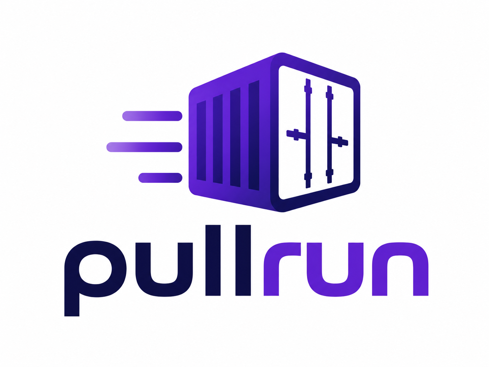

<div align="center">



# **Pullrun**

### *The AI agent sandbox runtime — a disposable microVM per task, booted from any OCI image in 200–500 ms depending on backend and warmth.*

**Give every agent task its own sandbox. Pullrun boots any OCI image as a hardened microVM (Firecracker or Apple Silicon), a Linux container, or a dense sandbox group — measured at ~500 ms Firecracker cold / ~200 ms warm, ~400 ms containers, ~160 ms to an Apple VM exec prompt, and ~185 ms for the 10th concurrent sandbox in a group. One content-addressed image store feeds all of them. Native MCP server, so opencode, Claude Code, and Cursor pull images, run tasks, exec, and commit filesystem state directly. The CLI can run without a persistent daemon; the MCP server, sync, and long-lived workloads use the runtime daemon. No overlayfs in the image store. No separate VM images.**

**One OCI image. Any execution target — agent sandbox, container, Firecracker microVM, Apple Silicon VM, or Kubernetes workload. CLI + runtime under 25 MB.**

[](https://github.com/pullrun/pullrun/actions/workflows/ci.yml)
[](https://doi.org/10.5281/zenodo.20679669)
[](https://github.com/pullrun/pullrun/releases)
[](LICENSE)
[](docs/PULLRUN_GUIDE.md)
[](docs/PULLRUN_GUIDE.md)
[](docs/WINDOWS.md)
[](cri/pullrun-cri/)
[](docs/ALL_MCP.md)
[](https://www.rust-lang.org)
[](https://golang.org)
[](#testing)
[](CONTRIBUTING.md)

</div>

<p align="center">
  <a href="#-what-is-pullrun"><b>⚡ What is Pullrun?</b></a> •
  <a href="#-agent-sandboxes"><b>🤖 Agent Sandboxes</b></a> •
  <a href="#-install"><b>⚡ 30-Second Install</b></a> •
  <a href="#-quick-start"><b>🚀 Quick Start</b></a> •
  <a href="#-why-pullrun"><b>🎯 Why Pullrun?</b></a> •
  <a href="#-mcp-ai-integration"><b>🔌 MCP for Agents</b></a> •
  <a href="#-kubernetes"><b>☸️ Kubernetes</b></a> •
  <a href="#-architecture"><b>🏗️ Architecture</b></a>
</p>

---

## ⚡ What is Pullrun?

Pullrun is the **sandbox runtime for AI agents** — and the same runtime underneath. It stores OCI layers in a content-addressed DAG (no overlayfs), syncs blocks peer-to-peer, and ships as a ~14 MB CLI + ~6 MB runtime daemon.

**The agent execution problem:** agents need to *run code* — and they need it fast, isolated, and cheap. Today that means unisolated execution on the host (dangerous), per-task Docker containers (~800 ms + a whole image copy per task), or heavyweight VM tooling built for long-lived servers, not task-scale churn. And agents need *state*: a sandbox that survives between turns, snapshots, and rollback.

**Pullrun's answer:**

```bash
# opencode, Claude Code, Cursor — drive the runtime over MCP:
pullrun mcp

# Or boot a task sandbox directly — any OCI image, zero setup:
pullrun run python:3.12 --backend vm --cmd "python" --cmd "-c" --cmd "print('hello')" --attach

# Snapshot completed work — the next run boots straight from this state:
pullrun commit <id> task-run-042:latest
```

**Key differentiators:**
- **MicroVM isolation per task** — untrusted agent code runs in its own Firecracker kernel, not a shared-host namespace. Containers and VMs boot from the *same* image, no separate build step
- **~400 ms task boots** — Firecracker cold boot ~500 ms, warm pool ~200 ms, containers ~400 ms, Apple Silicon VM ~160 ms
- **One image, any number of sandboxes** — the DAG store dedupes by content hash. Per-task VMs get reflink clones that share physical image blocks on APFS/btrfs/XFS; group sandboxes share one read-only base and the guest page cache (measured in [docs/GROUPS.md](docs/GROUPS.md))
- **State that persists** — `commit` captures a sandbox's filesystem (guest memory is not snapshotted yet); the next run boots from that rootfs
- **Sandbox groups** — one VM, concurrent sandboxes with private overlays and a shared guest page cache: 10 trivial sandboxes in ~185 ms, image cache warmed once (see [docs/GROUPS.md](docs/GROUPS.md))
- **Native MCP server** — 15 runtime tools (run, exec, logs, build, push…) + resources; works in stdio (opencode, Claude Code, Cursor) or SSE (remote agents)
- **P2P image distribution** — one registry pull per fleet, the rest sync peer-to-peer at LAN speed
- **~14 MB CLI + ~6 MB runtime daemon** (stripped) — no daemon required by default (CLI-only `pullrun run`), optional daemon for background services

**Also included:** Kubernetes CRI shim (beta), Docker Compose support, policy engine (ed25519 image signatures, SBOM, seccomp), P2P sync layer, and AES-256-GCM encrypted secrets — all in the same binary.

```bash
# Apple Silicon VM (macOS default) — 3 s
pullrun run alpine:3.18 --cmd "echo" --cmd "hello pullrun" --attach -t

# Firecracker microVM (Linux) — 400 ms
pullrun run alpine:3.18 --backend vm --cmd "echo" --cmd "hello pullrun" --attach -t

# Container (Linux) — 400 ms
pullrun run alpine:3.18 --cmd "echo" --cmd "hello pullrun"

# Windows WSL2 — same image, same command, same store
pullrun.exe run alpine:3.18 --cmd "echo" --cmd "hello pullrun"
```

---

## 📦 Install

```bash
# One command, any platform
curl -fsSL https://github.com/pullrun/pullrun/raw/main/install.sh | bash
```

| Platform | What you get |
|----------|-------------|
| **macOS** | `brew tap pullrun/tap && brew install pullrun` → native binary, no Xcode |
| **Linux** | APT package or direct download, systemd service (requires `runc` for containers, `/dev/kvm` for VMs) |
| **Windows** | `pullrun.exe` + WSL2 auto-provisioning, runc + Firecracker |

<details>
<summary>Manual install options</summary>

```bash
# macOS (Homebrew — pre-built, no build deps)
brew tap pullrun/tap && brew install pullrun

# From source
make build && export PATH="$PWD/bin:$PATH"

# Cross-compile Windows CLI
cd cli/pullrun && GOOS=windows GOARCH=amd64 CGO_ENABLED=0 go build -o pullrun.exe .
```
</details>

---

## 🚀 Quick Start

```bash
# ── Agent sandbox: 400 ms microVM from any OCI image ─────────
pullrun run python:3.12 --backend vm --cmd "python" --cmd "-c" --cmd "print('hi')" --attach
pullrun mcp                                # ...or hand the runtime to opencode/Claude Code/Cursor

# ── Pull any OCI image ──────────────────────────────────────────
pullrun pull alpine:3.18     # 968 ms — benchmark script at hack/bench.sh

# ── Run as a container (Linux) ─────────────────────────────────
pullrun run alpine:3.18 --cmd "echo" --cmd "hello pullrun"

# ── Run as a microVM (macOS/Linux) ─────────────────────────────
pullrun run alpine:3.18 --backend vm --cmd "echo" --cmd "hello" --attach -t

# ── Dense fleet: one VM, many concurrent sandboxes (macOS) ─────
GID=$(pullrun group create --image alpine:3.18)
pullrun group run "$GID" -- /bin/sh -c 'echo hi from a group sandbox'
pullrun group ls && pullrun group rm "$GID"

# ── Interactive shell with detach ──────────────────────────────
pullrun run alpine:3.18 --tty --attach --cmd /bin/sh
#   Ctrl-P Ctrl-Q  → detach (workload keeps running)
#   pullrun exec <id> -t /bin/sh → re-attach

# ── Background workload ────────────────────────────────────────
pullrun run alpine:3.18 --cmd /bin/sleep --cmd 3600

# ── Build & push (no Docker daemon needed) ─────────────────────
pullrun build ./Dockerfile . -t myapp:latest
pullrun build ./Dockerfile . -t myapp:latest --platform linux/amd64,linux/arm64
pullrun push <root-digest> ghcr.io/myorg/myimg:latest

# ── Export/import for air-gapped ───────────────────────────────
pullrun save <digest> -o myimage.tar
pullrun load -i myimage.tar

# ── Compose (separate binary) ────────────────────────────────
pullrun-compose up -f myapp/compose.yml               # containers (default on Linux)
pullrun-compose up -f myapp/compose.yml --backend vm   # same compose, VM isolation
pullrun-compose logs -f
pullrun-compose down

# ── Lifecycle ──────────────────────────────────────────────────
pullrun list                  # all workloads (pending/running/exited)
pullrun stop <id>
pullrun exec <id> /bin/echo hello
# Re-attach to a detached workload (allocates a fresh PTY)
pullrun exec <id> -t -- /bin/sh
# Or, for bidirectional I/O streaming without a new shell:
pullrun workload run <id>

# ── Image management ──────────────────────────────────────────
pullrun images                 # list pulled images in local DAG store
pullrun rmi alpine:3.18       # remove an image, cascade-delete unreachable layers
pullrun rmi sha256:abc...     # also works by digest

# ── GC (DAG store garbage collection) ─────────────────────────
pullrun gc                    # dry-run — report what would be deleted
pullrun gc --apply            # actually delete unreachable nodes
pullrun gc --apply --force    # bypass 90% safety guard

# ── Events & Stats ─────────────────────────────────────────────
pullrun events --types=WORKLOAD_STARTED,POLICY_DENIED
pullrun stats <id>

# ── Network ────────────────────────────────────────────────────
pullrun network create my-net --subnet 10.43.1.0/24
pullrun run alpine:3.18 --net bridge

# ── Secrets ────────────────────────────────────────────────────
pullrun secret create db_password -                     # from stdin
pullrun run myapp:latest --secret db_password

# ── Configs ────────────────────────────────────────────────────
pullrun config create nginx.conf ./nginx.conf       # from file
pullrun config create nginx.conf -                   # from stdin
pullrun run nginx:latest --config nginx.conf

# ── Diff & Inspect ─────────────────────────────────────────────
pullrun diff <id>
pullrun inspect <id>
pullrun commit <id> myapp:snapshot

# ── Login ──────────────────────────────────────────────────────
pullrun login ghcr.io
pullrun logout

# ── MCP (AI agents) ────────────────────────────────────────────
pullrun mcp                   # stdio mode (for opencode, Claude Code)
pullrun mcp --sse :8080       # SSE mode (for remote agents)

# ── P2P sync ───────────────────────────────────────────────────
pullrun-runtime daemon --sync-addr 0.0.0.0:9500
```

---

## 🤖 Agent Sandboxes

AI agents churn through sandboxes by the thousands. Pullrun is built for that churn — the DAG store makes the *N-th* sandbox essentially free.

| What agents need | Pullrun provides |
|------------------|------------------|
| Fast task boot | Firecracker VM **~500 ms cold** / **~200 ms warm pool**, container **~400 ms**, Apple Silicon VM **~160 ms** |
| Strong isolation | Kernel-per-task microVMs for untrusted code; group sandboxes share a guest kernel and are meant for trusted same-tenant tasks |
| Cheap per-sandbox storage | Base image stored once; reflink clones share blocks (APFS/btrfs/XFS); group sandboxes share one base + page cache |
| Low memory | Group sandboxes share the guest page cache (measured: 6 MiB warmed once, zero per extra reader); per-task VMs have independent guest memory |
| Cross-turn state | `commit` captures filesystem state → next run boots from that rootfs; guest-memory snapshot/restore is on the roadmap |
| Dense fleets | Sandbox groups: one VM hosting concurrent sandboxes (CLI: `pullrun group`) |
| Agent-native control | Native **MCP** — `run`, `exec`, `logs`, `build`, `push`, `list_images`, `compose_up`… (15 tools) |
| Guardrails | ed25519 image signatures, SBOM/CVSS gates, seccomp profiles, read-only rootfs, `no_new_privileges` |
| Fleet distribution | P2P image sync — one registry pull per cluster, rest delta-sync over LAN |

The same OCI image, the same command, the same store — sized for a single sandbox or a 10,000-agent fleet:

```bash
# one disposable microVM, direct from the CLI
pullrun run python:3.12 --backend vm --cmd "python" --cmd "-c" --cmd "1+1" --attach

# or an agent drives run/exec/build/push through MCP in plain English:
#   "pull python:3.12 and run it as a VM"
#   "exec into my sandbox and check /var/log"
#   "commit this sandbox so the next task starts from here"
```

> Sandboxes are also full OCI runtimes: switch `--backend vm` to `--backend container` for trusted, densely-packed code, or point it at Kubernetes via the [CRI shim](#-kubernetes).

---

## 👥 Sandbox Groups

One VM, many sandboxes. A group boots a single VM and runs sandboxes
concurrently inside it; all of them share the guest kernel and its page
cache, while each sandbox gets a private tmpfs overlay over the same
read-only image base.

```bash
GID=$(pullrun group create --image alpine:3.18)
pullrun group run "$GID" -- /bin/sh -c 'echo hi' &
pullrun group run "$GID" -- /bin/sh -c 'echo there' &
wait
pullrun group rm "$GID"
```

Measured on Apple Silicon (debug build, `alpine:3.18`):

| metric | result |
|---|---|
| group boot (one VM) | ~450-480 ms |
| 10 × `true`, sequential | 1,171 ms |
| 10 × `true`, concurrent | **185 ms** |
| 10 concurrent image readers | 355 ms (vs 1,395 ms sequential) |
| guest `Cached` after 1 / 5 / 10 readers | 9.3 / 9.3 / 9.3 MiB |

The image cache is warmed once (3.3 → 9.3 MiB) and adds nothing per
sandbox. Groups are macOS-only for now, sandboxes are network-isolated,
and writes are discarded when a sandbox exits. See
[docs/GROUPS.md](docs/GROUPS.md) for semantics, caveats, and the
reproduction script; [docs/TIERS.md](docs/TIERS.md) compares group,
per-task VM, and container latency on macOS and Linux, and
[docs/SNAPSHOTS.md](docs/SNAPSHOTS.md) covers VM memory snapshots, and
[docs/ACTORS.md](docs/ACTORS.md) covers stateful actors and golden
templates, [docs/EGRESS.md](docs/EGRESS.md) covers fail-closed egress,
[docs/SECURITY_STATUS.md](docs/SECURITY_STATUS.md) tracks verified
security properties, and [docs/CRI.md](docs/CRI.md) documents the
Kubernetes 1.37 CRI shim and conformance status.

---

## 🎯 Why Pullrun?

### 🏗️ Architecture is Everything

Docker's image store is an overlay filesystem, so overlayfs has historically been part of the container escape surface (CVE-2023-0386, CVE-2023-32629). Pullrun's image store is not an overlay: OCI layers are stored **as-is** by content hash, and the DAG is materialized into per-workload rootfs views. Overlayfs appears only as a confined runtime view (the optional container `--rootfs-overlay` mode and the guest-side upper layer of group sandboxes), never as the store.

Pullrun also mitigates **shared-kernel cross-container risks** that aren't specific to any storage driver — for example, kernel page-cache bugs like CVE-2026-31431 ("Copy Fail") affect all containers sharing a host kernel, regardless of the storage backend. Per-VM kernel isolation (Firecracker, Apple Virtualization) fully contains these. The DAG store makes the VM path zero-cost: the same image, no separate VM build step.

Pullrun is also **rootless by default** — no `sudo` needed, no daemon listening on a TCP socket, no attack surface from a central dockerd.

### 🔥 The Only Runtime with Containers + VMs from the Same Image

| Backend | Isolation | Pullrun | Docker | Podman |
|---------|-----------|:-------:|:------:|:------:|
| Linux containers (runc) | Process | ✅ | ✅ | ✅ |
| Firecracker microVMs | Per-VM kernel | ✅ | ❌ | ❌ |
| Apple Silicon VMs | Per-VM kernel | ✅ | ❌ | ❌ |
| Windows WSL2 containers | Process | ✅ | ✅ | ❌ |
| Windows Firecracker VMs | Per-VM kernel | ✅ | ❌ | ❌ |

**Same image, any isolation level.** No separate VM image build step. The OCI manifest IS the VM rootfs.

### 🧬 Content-Addressed DAG Store

Pullrun's store is built on [rkyv](https://github.com/rkyv/rkyv) + [mmap](https://github.com/RazrFalcon/memmap2-rs). OCI layers are stored once, deduplicated by content hash, and `mmap()`'d directly — no tar extraction, no overlayfs, no `dockerd` process owning the data.

> A `sha256:` digest is globally consistent. Every node that has pulled `alpine:3.18` stores **byte-identical** files on disk. This makes P2P sync trivial: blocks are verified by content hash, transferred delta-only, and deduplicated across the entire cluster.

### 📊 By the Numbers

| Metric | Pullrun | Docker |
|--------|:-------:|:------:|
| First `alpine:3.18` pull | **968 ms** | ~2 s |
| Container run latency | **~400 ms** | ~800 ms |
| Apple Virt VM boot | **~160 ms** | N/A |
| Firecracker VM cold boot | **~500 ms** | N/A |
| Firecracker VM warm pool | **~200 ms** | N/A |
| Idle daemon RSS | **24.6 MiB** | ~90 MiB |
| Binary size (stripped) | **~20 MB** (CLI + runtime) | ~75 MB |
| Rootless by default | ✅ | ❌ (`dockerd` as root) |
| Central daemon | Optional | Required |

<sup>Benchmarks: single-node, cold cache, `alpine:3.18` on Apple M3 (macOS 16) for Pullrun vs Docker Desktop 4.27. Container run latency measured from `run` command exit to workload PID alive. Apple VM boot measured to interactive `exec` prompt. Firecracker measurements on Linux x86_64 with KVM; warm pool configured with `--vm-warm-pool-size 4`. Pullrun daemon RSS measured after `pullrun pull alpine:3.18` + `pullrun run alpine:3.18 --tty --attach --cmd /bin/sh` then detached. Docker RSS from `docker run -d --name idle alpine:3.18 sleep 3600`.

Benchmarked with [`hyperfine`](https://github.com/sharkdp/hyperfine) (≥10 iterations, mean ± stddev reported). The benchmark script lives at [`hack/bench.sh`](hack/bench.sh) — run it yourself to reproduce the numbers.</sup>

---

## ✨ Features

### 🏃 Workload Lifecycle
`pull`, `run`, `stop`, `exec`, `attach`, `list`, `logs`, `stats`, `events`, `inspect`, `prune`, `rmi`, `gc` plus:

* **`commit`** — create a new image layer from a running container's current filesystem. The DAG store computes the delta against the original image, producing a content-addressed layer.
* **`diff`** — show file-level changes between a running workload and its original image. The store compares DAG trees to produce an add/modify/delete listing.
* **`update`** — live resource limit changes (CPU millicores, memory bytes) without restarting the workload.
* **`cp`** — bidirectional file copy between host and workload paths.
* **`save` / `load`** — OCI-compatible single-file tarball export/import for air-gapped environments. Re-import produces identical content hashes.
* **`login` / `logout`** — bearer token auth for private OCI registries.

### 🔧 Build
Native Dockerfile builder (`FROM`, `RUN`, `COPY`, `ADD`, `WORKDIR`, `ENV`, `CMD`, `ENTRYPOINT`) with content-addressed layer caching by instruction hash. Uses runc directly for `RUN` — no Docker daemon. Multi-platform builds via `--platform linux/amd64,linux/arm64`.

### 🏗️ OCI Kernel Images
Kernel binaries are first-class OCI content. `pullrun kernel install` downloads a vmlinux from an OCI registry into the DAG store. The `--kernel-image` flag lets any workload specify a custom kernel by OCI reference — same store-backed, content-addressed pipeline: verified by digest, cached forever, pushable to any registry.

### 🐳 Compose
Full Docker Compose-compatible workflow: `up`, `down`, `logs`, `ps`, `build`. Supports dependency ordering (topological sort), port mapping, environment variables, volumes (bind mounts), resource limits (CPU/memory), labels, and per-project bridge networks for isolation. Parses standard `docker-compose.yml` files via the [`compose-spec/compose-go`](https://github.com/compose-spec/compose-go) library.

Each service can run as a container or VM — use `--backend vm` to boot all services as Firecracker microVMs from the same compose file, no changes required.

### ☸️ Kubernetes CRI
Drop-in CRI shim at [`cri/pullrun-cri/`](cri/pullrun-cri/) — implement `RuntimeService` and `ImageService` from the Kubernetes CRI API. Maps pod sandboxes to pullrun workloads, supports RuntimeClass (`pullrun-container` / `pullrun-vm`), pod annotations for image/CPU/memory overrides, and streaming (exec, attach, port-forward).

A native **control-plane stub** lives in [`control-plane/`](control-plane/): `pullrun-controller` (scheduler) + `pullrun-agent` (per-node deployer) communicating over gRPC. This is a v1 work-in-progress with etcd, `.pullrun.local` DNS, and admission control planned — but the wire protocol is stable today.

### 🤖 MCP AI Integration
Native [Model Context Protocol](https://modelcontextprotocol.io) server exposing 15 runtime operations as MCP tools — `run`, `stop`, `exec`, `list`, `get`, `inspect`, `logs`, `stats`, `pull_image`, `list_images`, `build`, `push`, `prune`, `compose_up`, `compose_down` plus MCP resources (`pullrun://workload/{id}`, `pullrun://workload/{id}/logs`, `pullrun://store/info`, `pullrun://images`). Works in stdio mode (for opencode, Claude Code, Cursor) or SSE mode (for remote agents via HTTP).

### 🔐 Policy Engine
Gate workloads before they run — built-in support for:
- **ed25519 image signatures** — manifests signed over a canonical payload, key-ID matched against trusted keys (not Sigstore: no transparency log, no keyless signing)
- **SBOM** evaluation (CVSS scoring, ban by license)
- **Seccomp** profiles (`default` allowlist of ~50 syscalls, `unconfined`, or custom JSON)
- **Read-only rootfs** — prevents runtime tampering (write only to `--volume` mounts)
- **`no_new_privileges`** — blocks `setuid` and `capset` escalation
- Policy is declarative: `required_signature: true`, `max_cvss_score: 7.0`, `deny_licenses: ["GPL-3.0"]`

Compose all four: `--require-signature --readonly-rootfs --no-new-privileges --seccomp-profile default`.

Produce the attestations the gate checks for:

```bash
pullrun keygen -o signing-key.json            # prints the "<id>:<base64>" trusted key
pullrun sign alpine:3.18 --manifest <digest> --key signing-key.json
pullrun sbom attach --manifest <digest> --file cyclonedx.json
pullrun attest alpine:3.18 --manifest <digest>
```

The runtime verifies the signature against the key you pass as
`--trusted-key <id>:<base64>` before storing it, so a signature can only be
recorded by a key you already trust.

### 🌐 P2P Image Distribution
Nodes share image blocks peer-to-peer via gRPC + Bloom filters. One node pulls from the registry, the rest delta-sync from each other. Features: mDNS/discovery for zero-config LAN peer finding, Bloom filter cache to avoid redundant transfers, gossip protocol for peer state, delta computation, registrar service for peer tracking.

### 📡 Networking
User-defined bridge networks with IPAM, inbound/outbound port forwarding, DNS resolution, and `iptables` integration. Four modes per workload via `--net`: **`isolated`** (default for containers, loopback only with host proxy on `10.42.0.1`), **`bridge`** (shared `pullrun-br0` bridge, inter-workload communication), **`slirp`** (default for VMs, userspace NAT via slirp4netns — no bridge, no iptables), **`host`** (shares host namespace), **`none`** (no network). Isolation is enforced by the proxy, not per-workload VLANs.

### 🗝️ Encrypted Secrets
AES-256-GCM encryption at rest, decrypted into workload tmpfs at runtime. `pullrun secret create/get/ls/inspect/rm` — data stays encrypted on disk, only the runtime process can decrypt.

### 🔄 Export/Import
Single-file OCI-compatible tarball export for air-gapped environments. Re-import produces identical content hashes.

### 📊 Events & Observability
Real-time event stream via `pullrun events` — `IMAGE_PULLED`, `WORKLOAD_STARTED`, `POLICY_DENIED`, etc. Per-workload `stats` with CPU/memory. Prometheus metrics exporter built into the daemon. PrometheusRule alerting config in [`deploy/`](deploy/).

### 🧹 DAG Store Garbage Collection & Reference-Counted rmi
`pullrun rmi` removes an image by tag or digest with **immediate cascade deletion** of unreachable subtree nodes. Per-node refcounts (`node.refcount` sidecar files) preserve shared layers — a layer referenced by another image is never deleted until the last referencing image is removed. Crash recovery via `recompute_all_refcounts` on daemon startup rebuilds refcounts from all tagged image and workload roots.

`pullrun gc` reclaims unreachable DAG nodes (orphaned layers, manifests, blobs) that are no longer reachable from any tagged image or running workload. Features: dry-run by default (report only), `--apply` to actually delete, `--force` to bypass the 90% safety guard, op-lock protection for in-flight operations, VM kernel image pinning via `kernel_image_digest`. The store no longer grows forever.

### 🖥️ Interactive Shells
Full TTY support with **detach/re-attach** via `Ctrl-P Ctrl-Q`. Works across all backends (container, Firecracker VM, Apple VM). Detached workloads keep running — re-attach with `pullrun exec --tty <id> /bin/sh`. Even works on exited workloads (daemon starts a fresh sleep container).

### ❤️ Health Checks & Restart Policies
`pullrun run --health-cmd 'curl -f http://localhost:80'` — periodic health checks with configurable interval, timeout, and retries. `--restart on-failure|always|unless-stopped` controls automatic restart on exit. Health state is surfaced via `pullrun inspect` and `pullrun events`.

### 🗄️ VM State Persistence
Stopped VMs behave like hibernated machines — all writes preserved, restart on demand with `exec`. Backend specifics: **Apple Virt** rootfs persists via VirtioFS, **Firecracker** retains the ext4 image, **Container (runc)** rootfs is ephemeral (only `--volume` mounts survive). No re-pull needed.

### 🔐 Private Registries
`pullrun login <registry>` for bearer token auth. Daemon accepts `--insecure-registry` for plain-HTTP mirrors and air-gapped LAN caches.

---

## ☸ Kubernetes

Pullrun ships a CRI shim in [`cri/pullrun-cri/`](cri/pullrun-cri/) that implements the Kubernetes Container Runtime Interface. It maps pod sandboxes to pullrun workloads and supports:

- `RuntimeClass` — `pullrun-container` for runc containers, `pullrun-vm` for Firecracker VMs
- Pod annotations: `pullrun.io/image`, `pullrun.io/cpu-millicores`, `pullrun.io/memory-bytes`
- Streaming: exec, attach, port-forward
- Image management via the DAG store

Deploy as a DaemonSet with manifests in [`deploy/`](deploy/):

```bash
kubectl apply -f deploy/runtime-daemon.yaml
kubectl apply -f deploy/serviceaccount.yaml
kubectl apply -f deploy/servicemonitor.yaml
```

---

## 🤖 MCP AI Integration

Pullrun ships a native [Model Context Protocol](https://modelcontextprotocol.io) server — the agent's control plane for sandboxes. Any MCP-compatible agent (opencode, Claude Code, Cursor) can pull images, boot sandboxes, exec, inspect state, and ship builds through natural language:

```bash
# Start the MCP server
pullrun mcp

# In opencode or Claude Code, the agent can now:
#   "pull alpine and run it as a VM"
#   "exec into my-app and check the logs"
#   "show me all running workloads"
#   "run docker-compose up from my project"
```

The MCP server exposes 15 tools (run, stop, exec, list, logs, stats, pull_image, build, push, prune…) and 4 resource types (`pullrun://workload/{id}`, `pullrun://workload/{id}/logs`, `pullrun://store/info`, `pullrun://images`). SSE mode for remote agents: `pullrun mcp --sse :8080`. Full reference in [docs/ALL_MCP.md](docs/ALL_MCP.md).

---

## 🌐 P2P Image Distribution

```bash
# Node A — seed
pullrun-runtime daemon --sync-addr 0.0.0.0:9500

# Node B — pulls delta blocks from Node A
pullrun-runtime daemon --sync-addr 0.0.0.0:9501 \
  --sync-peers node-a.example.com:9500
```

Each block verified by content hash before acceptance — no trust required.

---

## 🔧 Backend Comparison

| Backend | Isolation | Platform | Boot Time | Best For |
|---------|-----------|----------|:---------:|----------|
| 🐧 Linux Containers (runc) | Process (namespace) | Linux, macOS, Windows (WSL2) | ~400 ms | Dev, CI/CD, dense packing |
| 🔥 Firecracker microVM | Per-VM kernel (KVM) | Linux x86_64, Windows (WSL2 x86_64) | ~500 ms cold / ~200 ms warm pool | Multi-tenant, untrusted workloads, compliance, fast-recycling sandboxes |
| 🍎 Apple Virtualization | Per-VM kernel (Hypervisor.framework) | macOS Apple Silicon | ~160 ms | macOS dev, Apple Silicon CI |

---

## 🏗️ Architecture

```
                              pullrun (Go CLI)
                   pull · run · build · compose · inspect
                   events · stats · network · secret · mcp
                              │
                              │ gRPC (UDS or TCP)
                              ▼
                   ┌─────────────────────────────────────┐
                   │         pullrun-runtime             │
                    │  ┌──────────┐   ┌──────────────────┐ │
                    │  │ Store    │   │ Executor         │ │
                    │  │ (DAG)    │   │ runc / VM        │ │
                    │  │ └ rkyv   │   │ └ VmPool (warm)  │ │
                    │  │ └ mmap   │   │                  │ │
                    │  │ └ DashMap│   │                  │ │
                   │  └────┬─────┘   └──────┬───────┘    │
                   │       │                │            │
                   │  ┌────┴────────────────┴────┐       │
                   │  │       Network            │       │
                   │  │  IPAM · Proxy · DNS      │       │
                   │  └──────────────────────────┘       │
                   │                                      │
                   │  Sync · Policy · Secrets · Metrics   │
                   └──────────────────────────────────────┘
                              │
                   ┌──────────┴──────────┐
                   │      Kubernetes     │
                   │  CRI shim · Runtime │
                   │  Class · Prometheus │
                   └─────────────────────┘
```

The store uses `DashMap<Digest, Arc<Mmap>>` for lock-free concurrent reads — the first reader pays for `mmap()` + page faults, every subsequent reader is a single atomic load. The Rust workspace is eleven crates (store, oci, exec, vm, net, vsock, sync, policy, runtime, init, gc); the Go side is the CLI, CRI shim, compose, and control-plane stub.

---

## 📁 Project Layout

```
proto/            # Protobuf definitions (single source of truth)
runtime/          # Rust workspace — core data plane
  pullrun-store/   # Zero-copy DAG store (rkyv + mmap + DashMap concurrent cache)
  pullrun-oci/     # OCI client + DAG converter
  pullrun-exec/    # Executor trait + runc wrapper
  pullrun-vm/      # Firecracker + Apple Virt backends, warm VM pool (pool.rs), pullrun-init guest agent
  pullrun-net/     # IPAM, proxy, DNS, iptables, slirp4netns
  pullrun-vsock/   # Vsock transport layer for VM guest-host communication
  pullrun-sync/    # P2P block sync (Bloom, mDNS, gossip)
  pullrun-policy/  # image signatures, SBOM, seccomp gates
  pullrun-runtime/ # gRPC daemon
cli/pullrun/      # Go CLI (cobra) — 30+ commands
cri/pullrun-cri/  # Kubernetes CRI shim
control-plane/    # Multi-node orchestration stub: pullrun-controller + pullrun-agent (v1 WIP)
cmd/pullrun-compose/ # Docker Compose-compatible CLI
deploy/           # K8s manifests, Prometheus rules, alerts
docs/             # Architecture, operations, policy, MCP
tools/            # Standalone smoke-test workspaces (apple-virt-exec, firecracker-smoke, etc.)
```

---

## 🧪 Testing

> **278 tests, 0 failures** — every commit is gated by the full suite
> (`cargo fmt --check`, `cargo test`, `go test ./...`, `golangci-lint`).

| Suite | Stack | What it covers | Tests |
|-------|-------|----------------|------:|
| `pullrun-store` | 🦀 Rust | DAG store, rkyv round-trips, op-locks | 30 |
| `pullrun-runtime` | 🦀 Rust | gRPC service, events, metrics, policy integration | 43 |
| `pullrun-vm` | 🦀 Rust | network, ext4 bases, OCI kernels, Apple Virt + group, Firecracker* | 31 |
| `pullrun-net` | 🦀 Rust | IPAM, firewall, proxy, DNS, loopback | 18 |
| `pullrun-policy` | 🦀 Rust | signatures, SBOM, gates | 17 |
| `pullrun-oci` | 🦀 Rust | confinement, bases/CoW, dockerfile, puller, converter, layouts | 30 |
| `pullrun-sync` | 🦀 Rust | P2P block sync, bloom, delta | 13 |
| `pullrun-vsock` | 🦀 Rust | vsock transport, group frames | 10 |
| `pullrun-exec` | 🦀 Rust | seccomp, rootless, OCI spec, overlay | 12 |
| `pullrun-gc` | 🦀 Rust | DAG garbage collection | 16 |
| `pullrun-init` | 🦀 Rust | guest agent, initramfs | 2 |
| `pullrun-cri` | 🐹 Go | CRI shim lifecycle, filestore | 20 |
| `pullrun-compose` | 🐹 Go | compose parsing, `up`/`down` flows | 15 |
| `pullrun` CLI | 🐹 Go | workload run, commands, attestations | 12 |
| `control-plane` | 🐹 Go | controller store | 9 |
| **Total** | | | **278** |

\* 2 Firecracker hardware tests are `#[ignore]`d (need /dev/kvm) — run manually:
`cargo test -p pullrun-vm --test firecracker_boot -- --include-ignored --nocapture`

```bash
cargo test                                   # Rust workspace: 222 tests
go test ./...                                # Go modules (cri, cli, compose, control-plane): 56 tests
cargo fmt --all --check && golangci-lint run ./...   # CI gates
```

End-to-end CRI behavior (exec stdin streaming, exit-code propagation, pod
teardown) is validated against a live `crictl` sandbox in a VM — see
[`AGENTS.md`](AGENTS.md) release notes for the full lifecycle checklist.

---

## 📚 Documentation

| Document | What You'll Find |
|----------|-----------------|
| [docs/PULLRUN_GUIDE.md](docs/PULLRUN_GUIDE.md) | Full user guide for all platforms |
| [docs/ARCHITECTURE.md](docs/ARCHITECTURE.md) | DAG store design, executor trait, network model |
| [docs/OPERATIONS.md](docs/OPERATIONS.md) | Deploying, monitoring, troubleshooting |
| [docs/POLICY.md](docs/POLICY.md) | Policy engine (signatures, SBOM, CVSS, license) |
| [docs/WINDOWS.md](docs/WINDOWS.md) | Windows/WSL2 setup, Firecracker, known issues |
| [docs/ALL_MCP.md](docs/ALL_MCP.md) | MCP server reference (AI agent integration) |
| [docs/cross-node-dag-sync.md](docs/cross-node-dag-sync.md) | P2P block sync design |

---

## 📄 Technical Report

A technical report describing the architecture is available in [`/paper`](./paper/pullrun_paper.pdf) and archived on Zenodo: https://doi.org/10.5281/zenodo.20679669

---

## 👤 Author

**Mohammed Boukaba** — product and architecture; built the Rust runtime, Go CLI, MCP server, policy engine, Kubernetes CRI shim, and the demo/site.

---

## 📄 License

Apache-2.0 — see [LICENSE](LICENSE). Contributions subject to [CLA.md](CLA.md).

---

## 💼 Commercial

Pullrun is open source (Apache-2.0) **and** a business. Enterprise capabilities, shipped today:

- **🛡️ Security Policy Engine** — deny-by-default image gate: ed25519 image-signature verification, CycloneDX SBOM checks (CVSS cap, license deny-list), evaluated at pull *and* run. Per-workload hardening: seccomp allowlists (`--seccomp-profile`), read-only rootfs, no-new-privileges.
- **📊 Observability** — Prometheus `/metrics` endpoint on the runtime daemon (`--metrics-addr`): pull/start latencies, running workloads, store size, sync peers. Live `pullrun stats` and an event stream (`pullrun events`) covering pulls, runs, exits, and every policy decision.
- **🔐 Secrets & Config** — Docker-style `secret` / `config` management (create, ls, inspect, rm), mounted under `/run/secrets`.
- **🌐 Air-Gapped Fleet Sync** — P2P image distribution between nodes, kernel-as-image updates, offline registries, DAG garbage collection (`pullrun gc`).
- **☸ Kubernetes CRI** — CRI shim (beta) with v4 streaming exec/attach and per-pod bridge subnets; run Pods on Firecracker VM backends via RuntimeClass.

Commercial offerings on top of these capabilities, available today:

- **🧠 Embedded Agent Sandboxes** — for AI agent platforms (Claude Code, opencode, Cursor-style products): license the runtime that boots a per-task microVM sandbox in **~500 ms cold / ~200 ms warm**, controlled over native MCP (15 tools). Fleet economics: one image base plus copy-on-write deltas — reflink clones for per-task VMs, and shared guest page cache for group sandboxes (measured in [docs/GROUPS.md](docs/GROUPS.md)).
- **🔒 Isolation & Guardrails for agents** — kernel-per-task microVMs for untrusted agent code, deny-by-default image policy, seccomp/read-only rootfs/no-new-privileges, policy decisions streamed as audit events.
- **☁️ Hosted Sandbox API** (planned) — managed sandbox endpoints: boot, run agent, snapshot state, resume — billed per active sandbox-second.
- **Enterprise License** — per-cluster licensing for production fleets: Kubernetes CRI runtime, agent sandbox farms at scale, air-gapped registries, kernel-as-image updates. Predictable per-node pricing.
- **Professional Services** — deployment and tuning on your infrastructure: custom executors/backends, P2P fleet network design, policy & seccomp hardening, Docker/containerd migrations, team training.
- **OEM & Embed** — per-seat OEM licensing, custom MCP tool surfaces, co-branded runtime, white-glove onboarding for agent platform vendors.
- **Managed Control Plane** (planned) — hosted SaaS: fleet-wide image sync, policy center, secrets, and observability across hundreds of nodes, billed per active sandbox.
- **Support & SLAs** — priority engineering support with response SLAs, security fixes, and backports.

Enterprise conversations: open an issue or email the maintainers via the GitHub repo.

---

<div align="center">

**Built with Rust 🦀 and Go 🐹**

</div>
